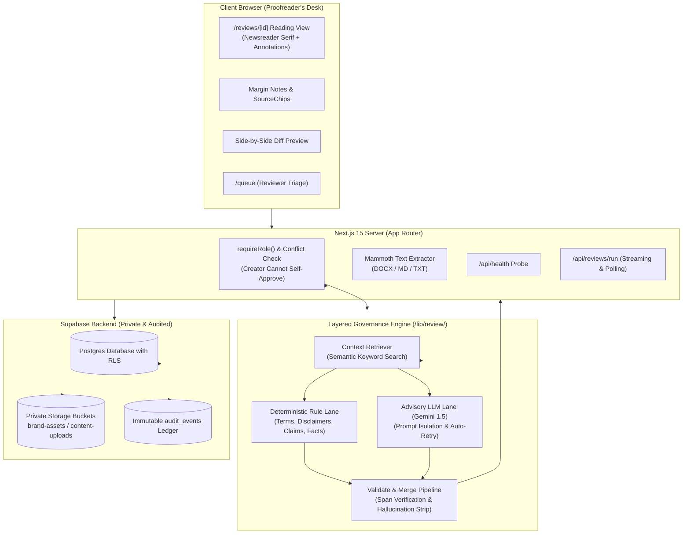

# BrandProof — Pre-Publication Brand Governance Workspace

> **Problem Statement:** Inkloom AI "Brand Governance" (Hackathon Submission)  
> **Fundamental Law:** *A clean automated scan NEVER equals approval.*  
> **Core Principle:** *AI is advisory. Sources are the authority. Humans decide.*

[](https://nextjs.org/)
[](https://www.typescriptlang.org/)
[](https://supabase.com/)
[](docs/test-results.md)
[](LICENSE)

---

## 1. Executive Summary & The Problem

Brand guidelines frequently decay into silent drift across omni-channel campaigns: a stale metric from last year's fact sheet, an unsubstantiated promotional superlative (`#1 logistics engine`), an off-tone slogan, or a prohibited term.

Conventional solutions fail in two opposite directions:
1. **Manual Document Reviews:** Reviewers cross-reference 60-page PDFs and multiple spreadsheets. Review cycles take 3–5 days, and reviewer fatigue leads to missed violations.
2. **Generic LLM Summaries:** Generic AI tools hallucinate brand authority by guessing whether a claim sounds plausible. They invent citations, miss exact terminology rules, and lack auditable evidence.

**BrandProof** introduces a pre-publication governance workspace:
- A creator submits a draft copy (`.docx`, `.md`, `.txt`, or pasted text).
- The engine checks it against an authoritative **Brand Pack** (approved guidelines, certified facts, prohibited terminology, brand assets).
- **Two Verification Lanes:**
  - *Deterministic Rule Lane:* Exact regex, word-boundary term registries, required disclaimers, and date-based expired fact matching.
  - *Context-Retrieved LLM Lane:* Tone register, implied claims, and ungrounded statements, guarded by prompt-injection defense.
- Every finding cites an exact approved source or is explicitly stamped `unverified` ("No approved source supports this").
- Non-destructive suggestions preserve the author's original voice in a side-by-side diff.
- A human reviewer reviews the queue, verifies creator dismissal justifications, and records signed approval or rejection reasons into an immutable audit ledger.

---

## 2. System Architecture



---

## 3. Tech Stack & Architectural Decisions

| Layer | Technology | Architectural Rationale |
| :--- | :--- | :--- |
| **Framework** | Next.js 15.5.29 App Router | React Server Components (RSC) for fast initial paint, Server Actions for strictly typed mutations, and Route Handlers for streaming review progress. Patched against CVE-2025-66478. |
| **Language** | TypeScript 5.9.3 | Strict mode enabled (`strict: true`). Zero `any` leaks at API boundaries; runtime parsing via Zod. |
| **Styling & Theme** | Tailwind CSS 3.4.19 | Bespoke editorial design system (`paper`, `ink`, `rule`, `oxblood`, `ochre`, `slate`, `moss`) adhering to anti-slop guidelines (no purple gradients, no glassmorphism, no AI sparkles). |
| **Database & Auth** | Supabase (Postgres + Auth) | Row Level Security (RLS) on all tables; private storage buckets for content uploads; Realtime WebSockets for reviewer comments and triage updates. |
| **LLM Provider** | Google Gemini 1.5 Flash | Placed behind a provider abstraction (`lib/llm/provider.ts`) with structured JSON schemas and prompt-isolation defense against adversarial prompt injection. |
| **Animation** | Framer Motion + GSAP / Lenis | `framer-motion` for internal UI transitions; `GSAP ScrollTrigger` + `Lenis` smooth scroll strictly reserved for the marketing landing page (`/`). |
| **Testing** | Vitest 5.1.0 | Fast, type-aware test suite covering unit rules, security boundaries, approval workflows, and seeded-draft benchmarks. |

---

## 4. Quick Start: Local Development

### Prerequisites
- Node.js `20+` or `22+`
- npm `10+`
- A Supabase project (or local Supabase instance)

### 1. Clone & Install Dependencies
```bash
git clone https://github.com/quantcode2008/CodeTitan.git
cd CodeTitan
npm install
```

### 2. Configure Environment Variables
Copy `.env.example` to `.env.local`:
```bash
cp .env.example .env.local
```
Fill in your configuration:
```env
NEXT_PUBLIC_SUPABASE_URL=https://your-project.supabase.co
NEXT_PUBLIC_SUPABASE_ANON_KEY=eyJhbGciOi...
SUPABASE_SERVICE_ROLE_KEY=eyJhbGciOi...
GEMINI_API_KEY=AIzaSy...
```

### 3. Run Database Migrations & Seed Data
See [Section 6: Supabase Setup](#6-exact-supabase-setup-steps) below for exact SQL commands.

### 4. Start Development Server
```bash
npm run dev
```
Open [http://localhost:3000](http://localhost:3000) in your browser.

---

## 5. Docker Deployment

BrandProof provides a multi-stage, production-hardened `Dockerfile` with non-root security and a dedicated `/api/health` container probe.

### Run with Docker Compose
```bash
docker-compose up --build
```

### Probe Container Health
```bash
curl http://localhost:3000/api/health
```
Response:
```json
{
  "status": "healthy",
  "timestamp": "2026-11-13T10:00:00.000Z",
  "uptime": 42.1,
  "version": "0.1.0",
  "services": {
    "app": "operational",
    "supabase": "configured",
    "llm": "configured"
  }
}
```

---

## 6. Exact Supabase Setup Steps

### 1. Execute SQL Migrations
Execute the migrations in sequential order in your Supabase SQL Editor:
1. `supabase/migrations/20261109000001_initial_schema.sql` (Creates workspaces, memberships, brand sources, terms, facts, content items, revisions, reviews, findings, audit events).
2. `supabase/migrations/20261109000002_rls_policies.sql` (Enforces Row Level Security across all tables and configures storage buckets).
3. `supabase/migrations/20261109000003_search_sources_rpc.sql` (Installs full-text keyword retrieval RPC for context grounding).

### 2. Seed Demo Workspace & Guidelines
Execute `supabase/seed.sql` to populate the `Apex Gear Co.` demo workspace with:
- Approved brand sources (`S-001` Tone Guide, `S-002` Claims Policy, `S-003` Materials Factsheet).
- Prohibited and preferred terminology registries (`cheap` $\to$ `accessible`).
- Validated and expired brand facts (e.g. 78% recycled nylon expired June 2024, active 84%).
- Seeded test drafts for immediate reviewer demonstration.

### 3. Verify Private Storage Buckets
Ensure the following storage buckets exist and are marked **Private** (`public: false`):
- `brand-assets` (Max 20MB: SVG, PNG, JPEG, WebP)
- `content-uploads` (Max 50MB: TXT, MD, DOCX)

### 4. Auth Redirect URLs
In Supabase Dashboard $\to$ **Authentication** $\to$ **URL Configuration**:
- Site URL: `http://localhost:3000` (or your production Vercel URL)
- Redirect URLs:
  - `http://localhost:3000/auth/callback`
  - `https://your-vercel-domain.vercel.app/auth/callback`

---

## 7. Demo Accounts & Workspace Roles

| Role | Email | Privileges & Governance Gates |
| :--- | :--- | :--- |
| **Admin** | `admin@brandproof.local` | Full access: mutate Brand Pack (sources, facts, terms, assets), invite members, and sign off as designated reviewer. |
| **Reviewer** | `reviewer@brandproof.local` | Triage queue access (`/queue`), review workspace, approve/reject drafts, record audit decisions. |
| **Creator** | `creator@brandproof.local` | Draft intake (`/reviews/new`), run automated scans, accept suggestion diffs, write dismissal justifications. *Cannot approve own drafts.* |

---

## 8. Step-by-Step Judge Demo Script

Follow this 5-minute walkthrough to evaluate all non-negotiable governance principles:

### Step 1: Inspect the Controlled Brand Pack (`/brand`)
1. Navigate to `/brand`.
2. Inspect the **Freshness Index**: View sources due for review (`review_by` date tracking).
3. Navigate to `/brand/sources`: Note sequential immutable keys (`S-001`, `S-002`).
4. Click on `S-002` (Claims and Substantiation Policy) to view the editorial reading view, version history, and "Used in N findings" counter.
5. Check `/brand/terms` (Prohibited term `cheap` $\to$ Replacement `accessible`) and `/brand/facts` (Expired 78% recycled nylon metric).

### Step 2: Submit a Flawed Draft Copy (`/reviews/new`)
1. Click **Submit New Draft Copy** (`/reviews/new`).
2. Title: `Apex Pro Launch Brief`. Channel: `Marketing Web`.
3. Paste the following representative copy (or upload a `.docx`):
   ```text
   Introducing the Apex Pro Line.
   As the #1 AI-powered supply engine in North America, we deliver unmatched speed.
   Our platform offers a guaranteed 40% reduction in logistical overhead.
   Built with 78% recycled nylon for sustainable durability.
   Switch today to our cheap starter tier for instant migration.
   ```
4. Click **Run Governance Review**.
5. Observe the calm, honest stage progress indicator (Retrieving sources $\to$ Checking deterministic rules $\to$ Analysing context $\to$ Validating evidence).

### Step 3: Inspect Findings & Exact Citations (`/reviews/[id]`)
1. The reading view opens in `Newsreader` font at comfortable reading width.
2. Note the visual proofreader marks:
   - **Critical wavy oxblood underline:** `#1 AI-powered supply engine` $\to$ Cites `[Unverified · Human Judgement Required]`.
   - **Major wavy ochre underline:** `guaranteed 40% reduction` $\to$ Conflicts with claims policy.
   - **Major wavy ochre underline:** `78% recycled nylon` $\to$ Expired June 2024 metric!
   - **Minor solid slate underline:** `cheap starter tier` $\to$ Prohibited word dictionary trigger.
3. Click on any annotation or margin note. Observe synchronized scrolling and source drawer opening with exact policy excerpts highlighted.

### Step 4: Accept Suggestion Diff & Dismiss with Reason
1. Under the `cheap starter tier` finding, click **Accept Suggestion**.
2. Observe the side-by-side diff: original text is preserved; suggestion updates non-destructively to `accessible starter tier`.
3. Try dismissing another finding: observe that BrandProof **mandates a written justification** before allowing dismissal.

### Step 5: Reviewer Triage & Conflict-of-Interest Enforcement (`/queue`)
1. Switch to a reviewer account and open `/queue`.
2. Notice drafts prioritized by open severity and age.
3. Notice that if a draft has an unverified critical finding, it requires a **Designated Reviewer** to sign off.
4. Try approving your own draft as creator: the server returns `403 Conflict of Interest: Creators cannot approve their own submissions`.
5. As an authorized reviewer, submit **Approve with Notes** or **Request Changes** (requires written rationale).

### Step 6: Verify Immutable Audit Trail (`/reviews/[id]/history`)
1. Navigate to `/reviews/[id]/history`.
2. Review the vertical Diataxis timeline recording:
   - Automated review run timestamp.
   - Finding suggestion accepted (with diff).
   - Finding dismissed with recorded creator justification.
   - Final reviewer approval decision with timestamp and reviewer identity.

### Step 7: Explore Governance Insights (`/insights`)
1. Navigate to `/insights`.
2. Review editorial charts (drawn in ink palette with direct labels):
   - **Rules Creators Trip Most:** Identifies confusing guidelines.
   - **Evidence Coverage %:** Tracks high-severity findings backed by verified citations.
   - **Recurrence Rate:** Shows percentage of violations persisting across revisions.

---

## 9. Test Suite & Verification Results

All 88 unit, evaluation, security, and integration tests are passing:

```bash
npm test
```

```text
 ✓ tests/review/rules.test.ts (12 tests)
 ✓ tests/insights/metrics.test.ts (9 tests)
 ✓ tests/review/security.test.ts (4 tests)
 ✓ tests/auth/require-role.test.ts (7 tests)
 ✓ tests/engine/deterministic.test.ts (5 tests)
 ✓ tests/review/merge.test.ts (6 tests)
 ✓ tests/brand/heading-splitter.test.ts (6 tests)
 ✓ tests/e2e/workflow-e2e.test.ts (3 tests)
 ✓ tests/eval/seeded-drafts.test.ts (3 tests)
 ✓ tests/engine/prompt-isolation.test.ts (5 tests)
 ✓ tests/brand/source-key.test.ts (7 tests)
 ✓ tests/review/llm-fallback.test.ts (2 tests)
 ✓ tests/engine/orchestrator.test.ts (4 tests)
 ✓ tests/review/approval-workflow.test.ts (7 tests)
 ✓ tests/content/extract.test.ts (8 tests)

 Test Files  15 passed (15)
      Tests  88 passed (88)
   Duration  1.72s
```

Detailed test logs and detection benchmark tables are available in [docs/test-results.md](docs/test-results.md).

---

## 10. Known Limitations

While BrandProof fulfills all core requirements of the Inkloom Brand Governance brief, we document the following transparent limitations:
1. **PDF Text Extraction:** PDF extraction is intentionally gated with a friendly notification ("PDF extraction not supported yet; upload .docx, .md, or .txt") because multi-column PDF layouts often scramble reading order.
2. **Local Vector Search:** Semantic context retrieval currently uses Postgres full-text keyword indexing and ranking RPC (`search_sources`). For production clusters exceeding 100,000 guidelines, enabling `pgvector` HNSW indexes is recommended.
3. **Multi-Region LLM Redundancy:** The default LLM adapter connects to Google Gemini via API. If the provider is unreachable, BrandProof gracefully falls back to deterministic rule-only mode with a warning banner rather than blocking creator work.
