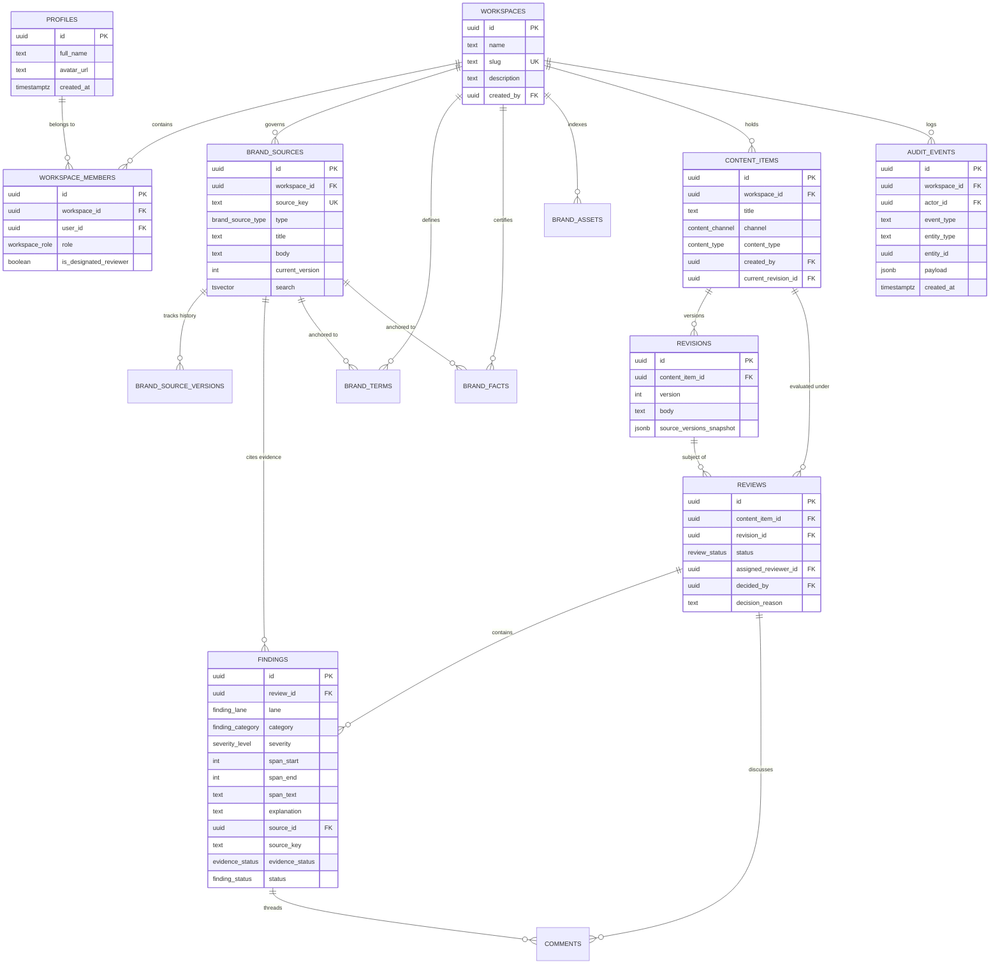

# BrandProof Data Model & Security Architecture

> **Architecture:** Pre-publication brand-governance workspace.
> **Database:** Supabase (PostgreSQL 15+, Auth, Storage, Row Level Security).
> **Non-Negotiable Rule:** Every single table has Row Level Security (RLS) enabled. Private storage buckets with path-prefixed workspace scoping.

---

## 1. Entity-Relationship Overview



---

## 2. Table Specifications

### 2.1 Identity & Multitenancy
- **`profiles`**: Linked 1:1 with Supabase `auth.users(id)`. Automatically provisioned via Postgres trigger upon user signup.
- **`workspaces`**: Tenant isolation container. All brand governance assets, drafts, and review histories belong to a workspace.
- **`workspace_members`**: Workspace membership with role-based access:
  - `admin`: Full administrative control over workspace settings, members, and brand knowledge base sources.
  - `creator`: Authoring role. Can create and edit their own drafts and revisions; cannot view drafts created by other creators.
  - `reviewer`: Auditing and approval authority. Can inspect all drafts in the workspace and issue formal decisions.
  - `is_designated_reviewer`: Flag for elevated reviewers required to approve high-risk/critical findings.

### 2.2 Controlled Brand Knowledge Base
- **`brand_sources`**: The authoritative source of truth. Every rule, tone guide, and claim policy is assigned a human-readable `source_key` (e.g., `S-014`). Includes a stored `tsvector` column for full-text search.
- **`brand_source_versions`**: Immutable historical archive. A database trigger automatically captures previous titles and bodies whenever a source is updated, bumping `current_version`.
- **`brand_terms`**: Exact terminology lexicon containing `prohibited` terms (with replacements), `preferred` vocabulary, and `required_phrase` disclosures (with mandatory severity levels).
- **`brand_facts`**: Certified metrics and facts with `valid_from` and `valid_until` date ranges to automate stale-statistic detection.
- **`brand_assets`**: Registered visual logos, badges, and photography with mandatory alt-text rules.

### 2.3 Drafts, Revisions & Review Workflow
- **`content_items`**: The parent document or copy asset. Tracks channel (`web`, `social`, `email`, `press`, `ad`), content type, and creator ownership.
- **`revisions`**: Individual revisions of draft text. Includes `source_versions_snapshot` JSONB capturing exact brand source versions active at time of revision.
- **`reviews`**: Governance lifecycle tracking the review state (`draft` → `needs_attention` → `ready_for_review` → `approved` | `changes_requested` | `rejected`).
- **`findings`**: Atomic brand annotations generated by either the `rule` lane (deterministic) or `llm` lane. Cites `source_id`, `source_key`, `evidence_status` (`verified`, `unverified`, `needs_human_judgement`), and resolution status.
- **`comments`**: Threaded reviewer/creator discussions attached to reviews or specific findings.
- **`audit_events`**: Immutable append-only governance log recording every review decision, finding resolution, and policy alteration.

---

## 3. Row Level Security (RLS) Policy Matrix

| Table | SELECT | INSERT | UPDATE | DELETE |
|---|---|---|---|---|
| `profiles` | Authenticated users | Self (`auth.uid() = id`) | Self (`auth.uid() = id`) | Prohibited |
| `workspaces` | Workspace members (`is_member`) | Authenticated | Workspace `admin` | Workspace `admin` |
| `workspace_members` | Workspace members | Workspace `admin` (or bootstrap) | Workspace `admin` | Workspace `admin` |
| `brand_sources` | Workspace members | Workspace `admin` | Workspace `admin` | Workspace `admin` |
| `brand_source_versions`| Workspace members | Admin / Trigger | Prohibited | Prohibited |
| `brand_terms` | Workspace members | Workspace `admin` | Workspace `admin` | Workspace `admin` |
| `brand_facts` | Workspace members | Workspace `admin` | Workspace `admin` | Workspace `admin` |
| `brand_assets` | Workspace members | Workspace `admin` | Workspace `admin` | Workspace `admin` |
| `content_items` | Author OR `reviewer`/`admin` | Workspace `creator` (own) | Author OR `admin` | Author OR `admin` |
| `revisions` | Author OR `reviewer`/`admin` | Author (own item) | Workspace `admin` | Workspace `admin` |
| `reviews` | Author OR `reviewer`/`admin` | Author OR `reviewer`/`admin`| `reviewer` OR `admin` (for decisions) | Workspace `admin` |
| `findings` | Author OR `reviewer`/`admin` | System / Member during scan | Author OR `reviewer`/`admin`| Workspace `admin` |
| `comments` | Review audience | Review audience (own author) | Author OR `admin` | Author OR `admin` |
| `audit_events` | `admin` OR `reviewer` | Workspace members | **REVOKED / BLOCKED** | **REVOKED / BLOCKED** |

---

## 4. Key Security Functions

### 4.1 Search Path Hardening
All helper functions run with explicit `SECURITY DEFINER` and hardened search path (`SET search_path = public, pg_temp`):
```sql
CREATE OR REPLACE FUNCTION is_member(lookup_workspace_id uuid)
RETURNS boolean
LANGUAGE sql
STABLE
SECURITY DEFINER
SET search_path = public, pg_temp
AS $$
  SELECT EXISTS (
    SELECT 1 FROM public.workspace_members
    WHERE workspace_id = lookup_workspace_id
      AND user_id = auth.uid()
  );
$$;
```

### 4.2 Append-Only Ledger Enforcement
The `audit_events` table enforces immutability at both the trigger and database privilege levels:
```sql
CREATE TRIGGER trg_audit_events_immutable
BEFORE UPDATE OR DELETE ON audit_events
FOR EACH ROW EXECUTE FUNCTION block_audit_events_mutation();

REVOKE UPDATE, DELETE, TRUNCATE ON audit_events FROM authenticated, anon, public;
```

---

## 5. Private Storage Architecture

Two private buckets are configured with zero public access:
1. **`brand-assets`**: Technical brand logos, emblems, typography assets.
   - Storage path: `{workspace_id}/{filename}`
   - Read policy: All members of `{workspace_id}`.
   - Write policy: Strictly restricted to workspace `admin`.
2. **`content-uploads`**: Creator drafts, PDFs, Word docs.
   - Storage path: `{workspace_id}/{filename}`
   - Read policy: Members of `{workspace_id}`.
   - Write policy: Workspace members.

